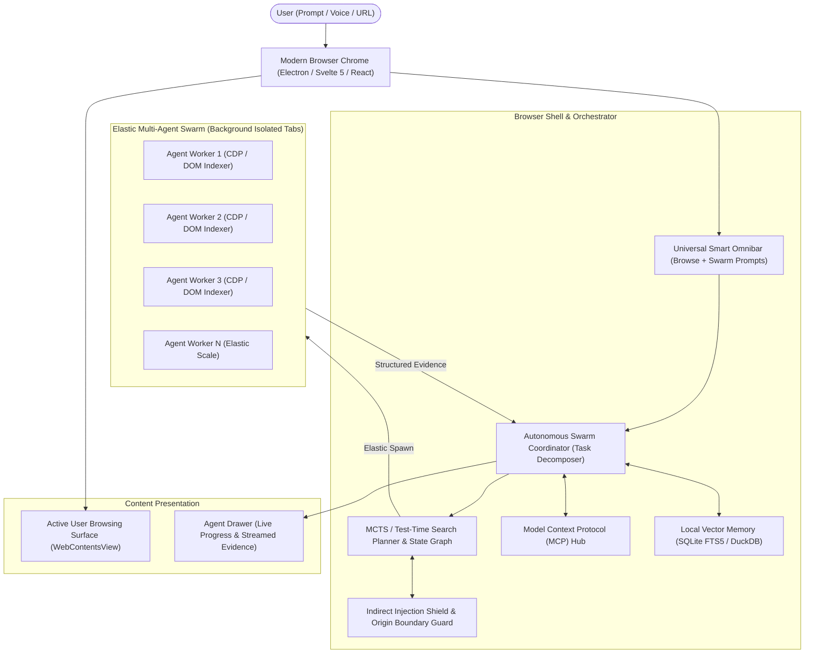

# Autonomous Browser (Project Codename: Aegis)

> **Next-Generation Autonomous Multi-Agent AI Browser with Elastic Swarms, Test-Time Tree Search, and Indirect Injection Immunity.**

---

## 🌟 Overview

The **Autonomous Browser** is a production-grade, open-source AI desktop browser engineered from the ground up to solve the fundamental limitations of single-agent and brittle screen-clicking systems (such as Strawberry Browser). 

Instead of chaining users to a single tab with slow, token-heavy screenshot loops, Autonomous Browser introduces:
1. **Elastic Chromium Swarms**: True parallel agent execution across 1 to 10+ background tabs without screen hijacking.
2. **Test-Time Tree Search (MCTS / Best-First Planning)**: Exploration, state backtracking, and dead-end recovery over complex workflows.
3. **Dual-Mode Precision Execution**: Physical pointer simulation (`CDP Input.dispatchMouseEvent`) and instantaneous semantic DOM node targeting (`data-agent-id`).
4. **Architectural Indirect Prompt Injection Defense**: Untrusted content isolation layers, Agent Origin Sets, and dual-model validation protecting user data and credentials.
5. **Universal Model Context Protocol (MCP)**: Native hub to connect external tools, filesystem access, local CLI tools, and databases.
6. **Local-First Privacy & Semantic Memory**: Embedded vector memory (DuckDB/SQLite FTS5) with 100% offline local LLM compatibility (Ollama, LM Studio) alongside cloud providers (Claude 3.7/3.5, Gemini 2.0, OpenAI).

---

## 🏗️ Architecture

---

## 🗺️ Master Directory: 100 Engineering Issues Breakdown

The entire architecture has been decomposed into **100 granular, production-ready issues** on GitHub:

### 1. Core Engine & Chromium Shell (Issues 1–2, 16–25)
* **[#1: M1.1: Project Scaffolding, TypeScript Config, and Hardened Electron Packaging](https://github.com/harshiit-rana/Autonomous-browser/issues/1)**
* **[#2: M1.2: Dual-Layer Window Architecture (Shell Chrome + WebContentsView)](https://github.com/harshiit-rana/Autonomous-browser/issues/2)**
* **[#16: CORE-01: Low-Latency Binary IPC Protocol (Dendrite-Lite)](https://github.com/harshiit-rana/Autonomous-browser/issues/16)**
* **[#17: CORE-02: CDP Session Pool & Multi-Target Lifecycle Manager](https://github.com/harshiit-rana/Autonomous-browser/issues/17)**
* **[#18: CORE-03: CDP Network Interception, Request Spoofing, and Mocking Engine](https://github.com/harshiit-rana/Autonomous-browser/issues/18)**
* **[#19: CORE-04: JavaScript Dialog Interception Bridge](https://github.com/harshiit-rana/Autonomous-browser/issues/19)**
* **[#20: CORE-05: Native File Chooser Interception & Autonomous Upload Manager](https://github.com/harshiit-rana/Autonomous-browser/issues/20)**
* **[#24: CORE-09: Robust Frame Tree Navigation & Cross-Origin Shadow DOM Traversal](https://github.com/harshiit-rana/Autonomous-browser/issues/24)**
* **[#25: CORE-10: Viewport Adaptation, Device Emulation, and Dynamic Zoom Handling](https://github.com/harshiit-rana/Autonomous-browser/issues/25)**

### 2. Perception, DOM Indexing & Stealth Input (Issues 3–4, 21–23, 26–30)
* **[#3: M2.1: Semantic DOM Tree Indexer & Persistent Handle Assignment](https://github.com/harshiit-rana/Autonomous-browser/issues/3)**
* **[#4: M2.2: Dual-Mode Execution Engine (Physical CDP Pointer + DOM Direct)](https://github.com/harshiit-rana/Autonomous-browser/issues/4)**
* **[#21: CORE-06: Human-Realistic Bezier Curve Mouse Trajectory Simulator](https://github.com/harshiit-rana/Autonomous-browser/issues/21)**
* **[#22: CORE-07: Human Cadence Keyboard Typer with Latency & Typo Simulation](https://github.com/harshiit-rana/Autonomous-browser/issues/22)**
* **[#23: CORE-08: Cross-Platform Anti-Bot Evasion & Navigator Fingerprint Masking](https://github.com/harshiit-rana/Autonomous-browser/issues/23)**
* **[#26: PERC-01: Accessibility Tree (AXTree) Extraction & Semantic Pruning](https://github.com/harshiit-rana/Autonomous-browser/issues/26)**
* **[#27: PERC-02: Visual 'Set-of-Mark' (SoM) Dynamic Overlay Generator](https://github.com/harshiit-rana/Autonomous-browser/issues/27)**
* **[#28: PERC-03: Real-Time DOM Mutation Observer & Visual Settle Detector](https://github.com/harshiit-rana/Autonomous-browser/issues/28)**
* **[#29: PERC-04: Spatial Relationship & Visual Hierarchy Reasoning Engine](https://github.com/harshiit-rana/Autonomous-browser/issues/29)**
* **[#30: PERC-05: Dynamic OCR & Canvas/SVG Text Extraction Fallback](https://github.com/harshiit-rana/Autonomous-browser/issues/30)**

### 3. Elastic Swarm Orchestration (Issues 5–6, 31–35)
* **[#5: M3.1: Elastic Swarm Orchestrator & Background Worker Tab Pool](https://github.com/harshiit-rana/Autonomous-browser/issues/5)**
* **[#6: M3.2: Hierarchical Task Decomposition & Swarm Coordinator](https://github.com/harshiit-rana/Autonomous-browser/issues/6)**
* **[#31: SWARM-01: Worker Tab Memory & Resource Throttler](https://github.com/harshiit-rana/Autonomous-browser/issues/31)**
* **[#32: SWARM-02: Shared Blackboard State & Distributed Evidence Store](https://github.com/harshiit-rana/Autonomous-browser/issues/32)**
* **[#33: SWARM-03: Dynamic Work-Stealing Queue for Parallel Crawling](https://github.com/harshiit-rana/Autonomous-browser/issues/33)**
* **[#34: SWARM-04: Swarm Synchronization & Barrier Primitives](https://github.com/harshiit-rana/Autonomous-browser/issues/34)**
* **[#35: SWARM-05: Worker Telemetry, Heartbeats, and Auto-Recovery Daemon](https://github.com/harshiit-rana/Autonomous-browser/issues/35)**

### 4. Test-Time Compute, MCTS & Backtracking Planning (Issues 7–8, 36–40)
* **[#7: M4.1: Test-Time Compute & MCTS Planning Engine](https://github.com/harshiit-rana/Autonomous-browser/issues/7)**
* **[#8: M4.2: Web State Snapshotting, Speculative Backtracking & Safety Rollbacks](https://github.com/harshiit-rana/Autonomous-browser/issues/8)**
* **[#36: PLAN-01: Web Action Space Formalization & Pruning Heuristics](https://github.com/harshiit-rana/Autonomous-browser/issues/36)**
* **[#37: PLAN-02: LLM Critic & State Value Function for MCTS](https://github.com/harshiit-rana/Autonomous-browser/issues/37)**
* **[#38: PLAN-03: Upper Confidence Bounds for Trees (UCT) Selection Policy](https://github.com/harshiit-rana/Autonomous-browser/issues/38)**
* **[#39: PLAN-04: Speculative Parallel Rollouts via Headless Clone Tabs](https://github.com/harshiit-rana/Autonomous-browser/issues/39)**
* **[#40: PLAN-05: Hierarchical High-Level Plan Space (Plan-MCTS)](https://github.com/harshiit-rana/Autonomous-browser/issues/40)**

### 5. Security & Indirect Prompt Injection Defense (Issues 9–10, 41–45)
* **[#9: M5.1: Indirect Prompt Injection Defense: Untrusted Content Isolation Layer](https://github.com/harshiit-rana/Autonomous-browser/issues/9)**
* **[#10: M5.2: Dual-Model Intent Guard & Agent Origin Boundary Enforcement](https://github.com/harshiit-rana/Autonomous-browser/issues/10)**
* **[#41: SEC-01: Strict Content Security Policy (CSP) & Script Sandboxing](https://github.com/harshiit-rana/Autonomous-browser/issues/41)**
* **[#42: SEC-02: Agent Origin Scope Locker (Per-Task Domain Whitelisting)](https://github.com/harshiit-rana/Autonomous-browser/issues/42)**
* **[#43: SEC-03: Dual-Model Intent Alignment Verifier (Pre-Action Gate)](https://github.com/harshiit-rana/Autonomous-browser/issues/43)**
* **[#44: SEC-04: Credential Masking & Sensitive Input Redaction Filter](https://github.com/harshiit-rana/Autonomous-browser/issues/44)**
* **[#45: SEC-05: Automated Indirect Prompt Injection Red-Teaming Suite](https://github.com/harshiit-rana/Autonomous-browser/issues/45)**

### 6. Universal MCP & Local Vector Memory (Issues 11–12, 46–50)
* **[#11: M6.1: Universal Model Context Protocol (MCP) Hub & Client Integration](https://github.com/harshiit-rana/Autonomous-browser/issues/11)**
* **[#12: M6.2: Local Privacy-First Semantic Vector Memory & Browsing Recall](https://github.com/harshiit-rana/Autonomous-browser/issues/12)**
* **[#46: MEM-01: SQLite FTS5 Full-Text Search Engine for Visited Page Content](https://github.com/harshiit-rana/Autonomous-browser/issues/46)**
* **[#47: MEM-02: On-Device Local Embedding Generation Pipeline](https://github.com/harshiit-rana/Autonomous-browser/issues/47)**
* **[#48: MEM-03: Vector Similarity Search & Hybrid RAG Retrieval Engine](https://github.com/harshiit-rana/Autonomous-browser/issues/48)**
* **[#49: MEM-04: Automated Daily Browsing Activity Summarizer (OptMem Parity)](https://github.com/harshiit-rana/Autonomous-browser/issues/49)**
* **[#50: MEM-05: Secure Encrypted Vault for User Credentials & API Keys](https://github.com/harshiit-rana/Autonomous-browser/issues/50)**

### 7. Modern Browser Chrome & UI (Issues 13–15, 51–55)
* **[#13: M7.1: Universal Smart Omnibar (Hybrid URL Navigation + Swarm Prompting)](https://github.com/harshiit-rana/Autonomous-browser/issues/13)**
* **[#14: M7.2: Swarm Activity Drawer & Live Streaming Execution Dashboard](https://github.com/harshiit-rana/Autonomous-browser/issues/14)**
* **[#15: M7.3: Pluggable Multi-Model Hub (Claude, Gemini, OpenAI, Ollama)](https://github.com/harshiit-rana/Autonomous-browser/issues/15)**
* **[#51: UI-01: Modern Glassmorphic Window Frame with Custom Titlebar](https://github.com/harshiit-rana/Autonomous-browser/issues/51)**
* **[#52: UI-02: Dynamic Tab Strip with Workspace & Profile Isolation](https://github.com/harshiit-rana/Autonomous-browser/issues/52)**
* **[#53: UI-03: Real-Time Swarm Progress Sidebar with Live Worker Stream Cards](https://github.com/harshiit-rana/Autonomous-browser/issues/53)**
* **[#54: UI-04: Floating Quick-Action Companion Pill (Voice & Global Shortcuts)](https://github.com/harshiit-rana/Autonomous-browser/issues/54)**
* **[#55: UI-05: Interactive Manual Takeover & Agent Debugger Inspector](https://github.com/harshiit-rana/Autonomous-browser/issues/55)**

### 8. Audio, Extensions & Infrastructure (Issues 56–60)
* **[#56: EXT-01: Chrome Extension Runtime & Manifest V3 Compatibility Subsystem](https://github.com/harshiit-rana/Autonomous-browser/issues/56)**
* **[#57: AUDIO-01: Windows WASAPI Audio Loopback Capture & Meeting Transcription](https://github.com/harshiit-rana/Autonomous-browser/issues/57)**
* **[#58: BENCH-01: End-to-End WebArena & Mind2Web Benchmark Evaluation Suite](https://github.com/harshiit-rana/Autonomous-browser/issues/58)**
* **[#59: INFRA-01: Automated Multi-Platform CI/CD Pipeline & GitHub Packager](https://github.com/harshiit-rana/Autonomous-browser/issues/59)**
* **[#60: INFRA-02: Comprehensive Documentation, Developer Guide, and Architecture Specs](https://github.com/harshiit-rana/Autonomous-browser/issues/60)**

### 9. State Persistence & Tab Lifecycle (Issues 61–68)
* **[#61: SESSION-01: Cross-Restart Session & Persistent Cookie Store Migration](https://github.com/harshiit-rana/Autonomous-browser/issues/61)**
* **[#62: SESSION-02: Headless State Handoff (Background-to-Foreground Promotion)](https://github.com/harshiit-rana/Autonomous-browser/issues/62)**
* **[#63: SESSION-03: Multi-Account Profile Isolation (Simultaneous Multi-Session)](https://github.com/harshiit-rana/Autonomous-browser/issues/63)**
* **[#64: SESSION-04: Network Offline Mode & Deterministic Trajectory Replay](https://github.com/harshiit-rana/Autonomous-browser/issues/64)**
* **[#65: SESSION-05: Auto-Save Form State & Crash Recovery Restoration Loop](https://github.com/harshiit-rana/Autonomous-browser/issues/65)**
* **[#66: SESSION-06: Tab Hibernation & Memory Compression Daemon](https://github.com/harshiit-rana/Autonomous-browser/issues/66)**
* **[#67: SESSION-07: Download Manager & Safe File Staging Pipeline](https://github.com/harshiit-rana/Autonomous-browser/issues/67)**
* **[#68: SESSION-08: Print-to-PDF & Web Artifact Archival Engine](https://github.com/harshiit-rana/Autonomous-browser/issues/68)**

### 10. Bot Challenges, Payments & Safety Gates (Issues 69–76)
* **[#69: STEALTH-02: Cloudflare & Turnstile Bot Challenge Human Delegation Bridge](https://github.com/harshiit-rana/Autonomous-browser/issues/69)**
* **[#70: STEALTH-03: WebRTC & AudioContext Fingerprint Normalization](https://github.com/harshiit-rana/Autonomous-browser/issues/70)**
* **[#71: STEALTH-04: Canvas & WebGL Pixel Noise Randomizer](https://github.com/harshiit-rana/Autonomous-browser/issues/71)**
* **[#72: GATE-01: Autonomous Checkout & High-Risk Transaction Confirmation Gate](https://github.com/harshiit-rana/Autonomous-browser/issues/72)**
* **[#73: GATE-02: Virtual Card & Masked Payment API Connector](https://github.com/harshiit-rana/Autonomous-browser/issues/73)**
* **[#74: GATE-03: Subscription & Recurring Charge Warning Scanner](https://github.com/harshiit-rana/Autonomous-browser/issues/74)**
* **[#75: GATE-04: Irreversible Action Warning Gate (Account Deletion Prevention)](https://github.com/harshiit-rana/Autonomous-browser/issues/75)**
* **[#76: GATE-05: OAuth & Social Login Handshake Delegator](https://github.com/harshiit-rana/Autonomous-browser/issues/76)**

### 11. Data Extraction, Spreadsheets & Export (Issues 77–84)
* **[#77: DATA-01: HTML Table to Excel / CSV High-Fidelity Extraction Engine](https://github.com/harshiit-rana/Autonomous-browser/issues/77)**
* **[#78: DATA-02: Autonomous Multi-Page Pagination Crawler](https://github.com/harshiit-rana/Autonomous-browser/issues/78)**
* **[#79: DATA-03: Structured JSON Schema Extraction Engine via LLM Guardrails](https://github.com/harshiit-rana/Autonomous-browser/issues/79)**
* **[#80: DATA-04: Markdown Report Synthesizer with Chart & Graph Generation](https://github.com/harshiit-rana/Autonomous-browser/issues/80)**
* **[#81: DATA-05: Real-Time Web Scraping Diff Engine (Competitive Price Tracking)](https://github.com/harshiit-rana/Autonomous-browser/issues/81)**
* **[#82: DATA-06: Headless WhatsApp & Messaging Alert Bridge](https://github.com/harshiit-rana/Autonomous-browser/issues/82)**
* **[#83: DATA-07: Clipboard Intelligence Hub (Smart Formats & Code Parsing)](https://github.com/harshiit-rana/Autonomous-browser/issues/83)**
* **[#84: DATA-08: Data Clean-Room Sanitizer (PII & Enterprise Compliance Stripping)](https://github.com/harshiit-rana/Autonomous-browser/issues/84)**

### 12. Scheduled Automations & Video Flight Recorders (Issues 85–92)
* **[#85: AUTO-01: Persistent Autonomous Task Scheduler (Cron & Event Triggers)](https://github.com/harshiit-rana/Autonomous-browser/issues/85)**
* **[#86: AUTO-02: Trigger-Based Autonomous Agents (Webhook & Event Listeners)](https://github.com/harshiit-rana/Autonomous-browser/issues/86)**
* **[#87: AUTO-03: Multi-Tab Synchronized Testing & Web QA Automation](https://github.com/harshiit-rana/Autonomous-browser/issues/87)**
* **[#88: AUTO-04: Batch Job Parallelization & CSV Parameter Expansion](https://github.com/harshiit-rana/Autonomous-browser/issues/88)**
* **[#89: AUTO-05: Flight Recorder Blackbox (Step-by-Step Execution Video Replay)](https://github.com/harshiit-rana/Autonomous-browser/issues/89)**
* **[#90: AUTO-06: Autonomous Research Agent with Iterative Web Search Querying](https://github.com/harshiit-rana/Autonomous-browser/issues/90)**
* **[#91: AUTO-07: Smart Browser Cache & Offline RAG Pre-Warmer](https://github.com/harshiit-rana/Autonomous-browser/issues/91)**
* **[#92: AUTO-08: Autonomous Form Filler with Smart Context Synthesis](https://github.com/harshiit-rana/Autonomous-browser/issues/92)**

### 13. Enterprise, Evals & Mobile Synchronization (Issues 93–100)
* **[#93: ENT-01: Enterprise Role-Based Access Control (RBAC) & Team Policies](https://github.com/harshiit-rana/Autonomous-browser/issues/93)**
* **[#94: ENT-02: Single Sign-On (SSO) & SAML/OIDC Enterprise Login Manager](https://github.com/harshiit-rana/Autonomous-browser/issues/94)**
* **[#95: EVAL-01: SWE-Bench & WebBench Autonomous Agent Evaluation Harness](https://github.com/harshiit-rana/Autonomous-browser/issues/95)**
* **[#96: EVAL-02: User Intervention Analytics & Self-Improvement Telemetry](https://github.com/harshiit-rana/Autonomous-browser/issues/96)**
* **[#97: LOC-01: Autonomous Multi-Lingual Page Translation & Context Normalization](https://github.com/harshiit-rana/Autonomous-browser/issues/97)**
* **[#98: LOC-02: Accessibility WCAG 2.1 AA Compliance & Screen Reader Audit Tool](https://github.com/harshiit-rana/Autonomous-browser/issues/98)**
* **[#99: SYNC-01: Multi-Device Swarm Synchronization (Mobile Companion App)](https://github.com/harshiit-rana/Autonomous-browser/issues/99)**
* **[#100: RELEASE-01: Zero-Config One-Click Desktop Installer & Auto-Updater](https://github.com/harshiit-rana/Autonomous-browser/issues/100)**

---

## 🛠️ Tech Stack

- **Runtime / Shell**: Electron 33+, Node.js 22+, TypeScript
- **Frontend Chrome**: Svelte 5 (or React 19) + Tailwind CSS + Lucide Icons
- **Browser Automation Core**: Chromium DevTools Protocol (CDP) + Playwright Core
- **Database / Memory**: `better-sqlite3` + FTS5, Vector Embeddings
- **Protocol**: Model Context Protocol (MCP) SDK
- **LLM Integrations**: Claude (ACP/Anthropic), Gemini (Google GenAI), OpenAI, Ollama / Local OpenAI-compatible APIs

---

## 📄 License

MIT License. See [LICENSE](LICENSE) for details.
