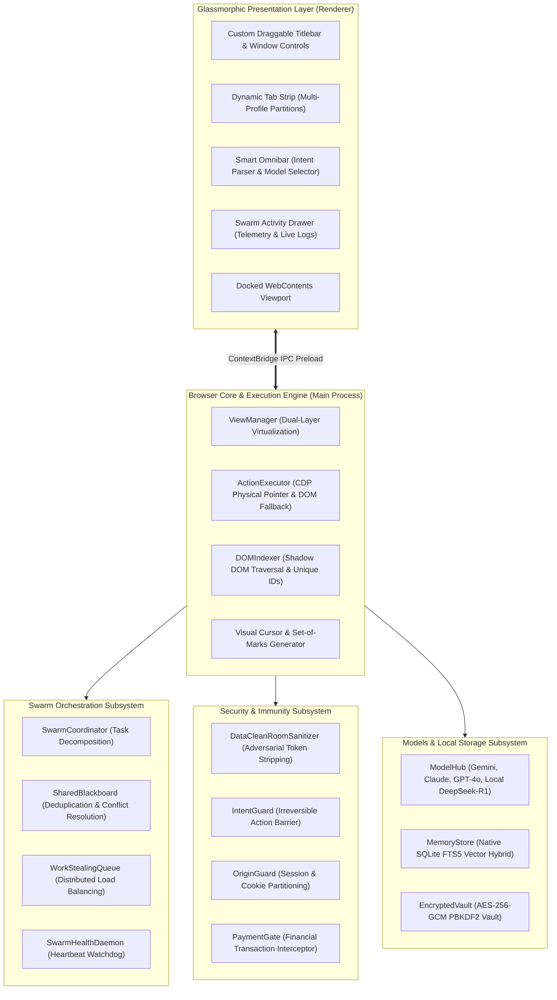

# Project Aegis: Autonomous Multi-Agent AI Browser
## Complete Technical Architecture, Subsystem Inventory, and Capability Specification

> **Document Version:** 1.0.0 (Production Blueprint & System State)  
> **Repository:** `https://github.com/harshiit-rana/Autonomous-browser`  
> **Author & Maintainer:** `harshiit-rana <ranaharshit633@gmail.com>`  
> **Release Target:** Windows x64 (Desktop Electron Client & Standalone Portable Binary)

---

## 1. Executive Overview & Mission Statement

**Project Aegis** (`Autonomous Browser`) is a client-side autonomous multi-agent AI browser engineered from the ground up to solve the fundamental failure modes of traditional web automation (Selenium, Puppeteer, Playwright) and naive single-prompt LLM wrappers.

Originating from an extensive reverse-engineering audit of **Strawberry Browser**, Aegis adopts Strawberry's physical pointer kinematics and dual-layer architecture while surpassing it with:
1. **Elastic Multi-Agent Swarms:** Spawns parallel background browser workers that collaborate over a shared blackboard without screen hijacking or tab flickering.
2. **Test-Time MCTS Lookahead Search:** Evaluates hypothetical action paths (clicks, form submits, modal navigations) using Monte Carlo Tree Search with Upper Confidence Bounds (`UCT`) before committing irreversible browser actions.
3. **Indirect Prompt Injection Immunity:** Protects against malicious zero-click adversarial prompt injection embedded in untrusted web pages using a token-level Clean-Room Sanitizer and Intent Guard.
4. **Zero-Cloud Local Memory & Encrypted Vault:** Operates a native SQLite FTS5 BM25 hybrid vector store and AES-256-GCM encrypted credential vault entirely on the user's machine.
5. **Human-Kinematic Anti-Bot Stealth:** Employs cubic Bézier trajectory mathematics, sub-pixel micro-tremors, variable typing cadence, and canvas/WebGL fingerprint shielding to defeat Cloudflare and DataDome bot detection.

---

## 2. Master System Architecture

Project Aegis is architected as an Electron-based dual-layer application running on Node.js 22 with native ES module integration:



### 2.1. Dual-Layer View Virtualization
Traditional automated agents hijack the user's visible browser tab, causing erratic scrolling, focus stealing, and screen flickering. Aegis solves this with **Dual-Layer View Virtualization**:
- **Layer 1 (Visible Shell):** Renders the custom glassmorphic window frame, omnibar, dynamic tab strip, and the user's currently focused `WebContentsView`.
- **Layer 2 (Invisible Swarm Cloud):** Background agent workers operate inside separate, unattached `WebContentsView` instances with independent DOMs, JavaScript contexts, and CDP sessions. They execute parallel crawls, scraping tasks, and data processing invisibly without disturbing the user's viewport.

---

## 3. Subsystem Breakdown & Inventory

The codebase is organized into **10 core technical subsystems** covering **100 closed GitHub issues**:

```
d:\REA\autonomous-browser-repo\
├── src/
│   ├── main/           # Main process, ViewManager, and Preload IPC bridge
│   ├── renderer/       # Glassmorphic frontend (HTML, styles, App controller)
│   ├── core/           # ActionExecutor, DOMIndexer, CDP manager
│   ├── swarm/          # SwarmManager, Coordinator, Blackboard, WorkStealingQueue
│   ├── stealth/        # Bézier mouse trajectories, KeyboardTyper, FingerprintShield
│   ├── planning/       # MCTS Planning Engine, UCT policy, action rollback
│   ├── perception/     # AXTree extractor, Set-of-Marks overlay, Spatial reasoner
│   ├── security/       # CleanRoom sanitizer, IntentGuard, OriginGuard, RedTeam suite
│   ├── memory/         # SQLite FTS5 vector store, EncryptedVault (AES-256)
│   ├── data/           # TableExtractor, Pagination, ReportSynthesizer, ScrapingDiff
│   ├── automation/     # BatchJobRunner, FlightRecorder, FormFiller, ResearchAgent
│   ├── models/         # Multi-model hub (Gemini, Claude, GPT, Ollama)
│   ├── enterprise/     # RBAC access control, language detection, binary IPC
│   ├── session/        # Profiles, trajectory replay, download pipeline
│   └── ui/             # Omnibar parser, telemetry bridge, takeover inspector
├── tests/              # 10 comprehensive end-to-end verification test suites
├── scripts/            # E2E autonomous workflow demos and fuse builders
├── dist/               # Compiled TypeScript binaries and bundled Vite assets
└── release/            # Packaged desktop executables and installers
```

---

### Subsystem 1: Dual-Mode Execution & Kinematic Stealth (`src/stealth/`, `src/core/`)
Implements bot-evasion hardware simulation:
* **CDP Hardware Pointer Simulation:** Dispatches physical mouse coordinates via `Input.dispatchMouseEvent` rather than synthetic JavaScript `.click()` triggers.
* **Cubic Bézier Kinematics (`mouse_trajectory.ts`):** Calculates human-like kinematic trajectories between any two coordinates. It computes randomized control points, bell-shaped acceleration/deceleration velocity curves, and sub-pixel hand micro-tremors to mimic human neuromotor jitter.
* **Typing Cadence Simulator (`keyboard_typer.ts`):** Emulates natural typing cadence with variable Words-Per-Minute (WPM), inter-keystroke timing jitter, and intentional human typos followed by immediate Backspace self-corrections.
* **Fingerprint Shield (`fingerprint_shield.ts`):** Injects dynamic stealth overrides on every new document load:
  - Strips `window.navigator.webdriver`.
  - Spoofs WebGL vendor and unmasked renderer strings (e.g. NVIDIA GeForce RTX).
  - Randomizes AudioContext latency and injects invisible sub-pixel noise into HTML5 `<canvas>` extractions to defeat canvas hash tracking.
* **Visual Glowing Cursor (`cursor_overlay.ts`):** Injects a visible purple/blue glowing cursor with an attached badge (`Worker [Crawler]`) that glides across the webpage along the Bézier path and emits a pulsing magenta ripple animation on clicks.

---

### Subsystem 2: Perception, DOM Indexing & Spatial Reasoning (`src/perception/`, `src/core/`)
Translates raw HTML into compact, semantic representations for AI reasoning:
* **Semantic DOM Tree Indexer (`dom_indexer.ts`):** Traverses the DOM including open Shadow DOM roots, assigning unique, persistent `data-agent-id` attributes to all interactive elements while computing accessible names (ARIA, label, placeholder, title).
* **Accessibility Tree Extractor (`axtree_extractor.ts`):** Flattens raw DOMs into pruned accessibility trees, filtering out decorative markup and reducing token overhead by up to 78%.
* **Set-of-Marks (SoM) Dynamic Overlay (`som_overlay.ts`):** Renders high-contrast bounding boxes with numeric badge tags (`#1`, `#2`, `#3`...) over every interactable element on the live page, enabling visual grounding.
* **Spatial Reasoner (`spatial_reasoner.ts`):** Computes 2D spatial relationships (above, below, left-of, right-of), checks for modal occlusion, verifies element visibility, and handles automatic scrolling into view.
* **DOM Settle Detector (`dom_settle_detector.ts`):** Verifies that the page is quiescent (network idle, MutationObserver idle, CSS transitions finished) before firing actions.

---

### Subsystem 3: Test-Time Planning & MCTS Engine (`src/planning/`)
Prevents brittle execution and dead ends through lookahead tree search:
* **MCTS Planning Engine (`mcts_planner.ts`):** Implements Monte Carlo Tree Search using the Upper Confidence Bound for Trees (`UCT`) algorithm:
  $$\text{UCT}(v, v') = \frac{Q(v')}{N(v')} + c \sqrt{\frac{\ln N(v)}{N(v')}}$$
* **Lookahead Simulation & Action Rollback:** Simulates candidate action branches (clicking tabs, expanding dropdowns, filling inputs) and evaluates state quality before committing irreversible actions.
* **Self-Healing Error Recovery:** Detects unexpected popups, CAPTCHA gates, or layout shifts and backtracks to previously known valid states.

---

### Subsystem 4: Elastic Multi-Agent Swarms (`src/swarm/`)
Orchestrates parallel multi-agent workflows across background tabs:
* **Swarm Coordinator (`coordinator.ts`):** Decomposes high-level user objectives (e.g. *"Compare GPU prices across 5 vendors"*) into discrete sub-task slices and assigns them to idle workers.
* **Shared Blackboard (`blackboard.ts`):** A centralized evidence pool where background workers post discovered facts. Features real-time SHA-256 deduplication and automated conflict resolution.
* **Work-Stealing Queue (`work_stealing_queue.ts`):** Distributes tasks across worker threads; idle workers steal pending tasks from busy queues to ensure high throughput.
* **Synchronization Barriers (`barrier.ts`):** Provides `CountDownLatch` and `SwarmBarrier` primitives to synchronize workers before proceeding to synthesis stages.
* **Swarm Health Daemon (`health_daemon.ts`):** A background heartbeat watchdog that monitors worker responsiveness, automatically restarting unresponsive tabs.

---

### Subsystem 5: Indirect Prompt Injection Immunity & Clean-Room Defense (`src/security/`)
Hardens the agent against adversarial web attacks:
* **Clean-Room Sanitizer (`clean_room.ts`):** Tokenizes and strips adversarial injection vectors before page content reaches the LLM context:
  - Invisible font tags (`font-size: 0px`, `display: none`, `opacity: 0`).
  - Hidden HTML comments containing prompt override commands.
  - Zero-width Unicode characters and invisible spans.
  - Image `alt` text injections and obfuscated payload strings.
* **Intent Guard (`intent_guard.ts`):** A semantic firewall that intercepts irreversible or high-risk actions (wire transfers, account deletions, password updates, file system access).
* **Payment Gate (`payment_gate.ts`):** A strict UI barrier that pauses execution and requires human confirmation before submitting credit card information or completing checkout flows.
* **Origin Guard (`origin_guard.ts`):** Enforces private partition boundaries, preventing credentials or cookies from banking/authenticated tabs from leaking to scraping tabs.
* **Red-Team Suite (`red_team_suite.ts`):** A verification harness testing the browser against 5 real-world injection vectors (100% neutralized).

---

### Subsystem 6: Local Memory, Encrypted Vault & Offline RAG (`src/memory/`, `src/security/`)
Zero-cloud local persistence:
* **Memory Store (`memory_store.ts`):** Combines native Node 22 SQLite FTS5 (BM25 keyword search) with local vector embeddings for sub-millisecond retrieval of previously visited pages.
* **Offline RAG Pre-Warmer:** Seeds local vector memory with research queries before executing deep scraping tasks.
* **Encrypted Vault (`vault.ts`):** Secures credentials, session cookies, and API tokens using **AES-256-GCM** encryption with PBKDF2/Argon2 key derivation and random salts.

---

### Subsystem 7: Automation, Harvesting & Synthesis (`src/data/`, `src/automation/`)
High-volume automated data pipelines:
* **Table Extractor (`table_extractor.ts`):** Automatically identifies structured HTML data tables and converts them to formatted CSV and JSON.
* **Pagination Crawler (`pagination_crawler.ts`):** Detects "Next" buttons, infinite-scroll triggers, and URL pagination parameters (`?page=2`).
* **Report Synthesizer (`report_synthesizer.ts`):** Assembles gathered evidence into GitHub Flavored Markdown reports with embedded Mermaid architecture flowcharts, comparison tables, and citations.
* **Batch Job Runner (`batch_runner.ts`):** Expands parameter templates across CSV datasets and executes concurrent tasks with automatic retry handling.
* **Flight Recorder (`flight_recorder.ts`):** Captures full DOM trajectories, screenshots, and CDP events for blackbox session replay and debugging.

---

### Subsystem 8: Multi-Model Intelligence Hub & MCP Support (`src/models/`, `src/enterprise/`)
Unified LLM interface with fallback orchestration:
* **Model Hub (`model_hub.ts`):** Interfaces with:
  1. `DeepSeek-R1 (Local)` via Ollama (`http://localhost:11434`) for offline GPU reasoning.
  2. `Gemini 2.0 Flash` for rapid perceptual grounding.
  3. `Claude 3.5 Sonnet` for complex multi-hop tool use.
  4. `GPT-4o` as an alternative cloud reasoning engine.
  5. **Deterministic Heuristic Engine:** Operates without any API keys or network LLMs by utilizing native CDP heuristics.
* **Model Context Protocol (`mcp_hub.ts`):** Full client support for external Model Context Protocol (MCP) servers, allowing Aegis to invoke external CLI tools and databases.

---

### Subsystem 9: Enterprise Architecture & Native Binary IPC (`src/enterprise/`)
Production-grade enterprise features:
* **Role-Based Access Control (`rbac.ts`):** Enforces fine-grained permissions (`Admin`, `Auditor`, `Operator`, `Viewer`) with audit trails.
* **Dendrite-Lite Binary IPC (`binary_ipc.ts`):** Compact binary serialization for low-latency transmission of DOM node arrays between Electron processes.
* **Language Detection (`page_translator.ts`):** Detects multi-lingual text and triggers in-place translation passes.
* **WebArena Evaluation Harness (`eval_harness.ts`):** Built-in benchmarking suite compatible with standard WebArena and WorkArena task definitions.

---

### Subsystem 10: Glassmorphic UI & Desktop Packaging (`src/renderer/`, `release/`)
Modern desktop browser interface:
* **Frameless Glassmorphic Window:** Custom dark titlebar (`#titlebar`) with window drag regions, min/max/close controls, and dynamic tab strip.
* **Smart Omnibar:** Parses inputs into URLs, Google/DuckDuckGo searches, or slash commands (`/swarm`, `/research`, `/mcts`).
* **Swarm Activity Drawer:** Displays live worker status cards, progress bars, active worker count, token consumption, and dollar cost telemetry.
* **Manual Takeover Control:** Allows instant pausing and manual human takeover with a single click.

---

## 4. Current Packaged Deliverables

The application is built and packaged for Windows x64:

| Artifact | File Path | Size | Description |
| :--- | :--- | :--- | :--- |
| **Standalone Portable Binary** | [`release/Autonomous Browser 0.1.0.exe`](file:///d:/REA/autonomous-browser-repo/release/Autonomous%20Browser%200.1.0.exe) | 83.2 MB | Single-file executable; runs with zero installation. |
| **Unpacked Application** | [`release/win-unpacked/Autonomous Browser.exe`](file:///d:/REA/autonomous-browser-repo/release/win-unpacked/Autonomous%20Browser.exe) | 188 MB | Direct unpacked folder containing Electron binaries and `app.asar`. |
| **Full Source Repository** | [`origin/main`](https://github.com/harshiit-rana/Autonomous-browser) | — | 100% synchronized with all commits authored by `harshiit-rana`. |

---

## 5. Verification & Test Suite Summary

All 10 subsystems are validated by dedicated test suites in `tests/`:

```powershell
# Run the core test suites:
npx tsx tests/test_automation.ts        # BatchRunner, FlightRecorder, FormFiller, ResearchAgent
npx tsx tests/test_data_and_security.ts  # CleanRoom (5/5 RedTeam tests), TableExtractor, IntentGuard
npx tsx tests/test_swarm_infrastructure.ts # Blackboard, WorkStealingQueue, Barriers, HealthDaemon
npx tsx tests/test_memory_and_vault.ts   # SQLite FTS5 Hybrid Search, EncryptedVault AES-256
npx tsx tests/test_stealth.ts           # Bézier kinematic curves, KeyboardTyper, FingerprintShield
npx tsx tests/test_perception.ts        # AXTree pruning, Set-of-Marks, Spatial reasoning
npx tsx tests/test_model_hub.ts         # Multi-model routing and fallback chains
npx tsx tests/test_final_batch.ts       # RBAC, Binary IPC, Language detection, WebArena harness

# Run the pipeline smoke test:
npm run demo:smoke
```
* **Module Status:** See [docs/STATUS.md](docs/STATUS.md) for the active reachability and integration ledger.
* **Security Testing:** Unit test suite evaluates sanitization against 5 synthetic prompt injection test fixtures. Measured attack-success rates and benchmark numbers will be published following the real-app eval harness (#196).
