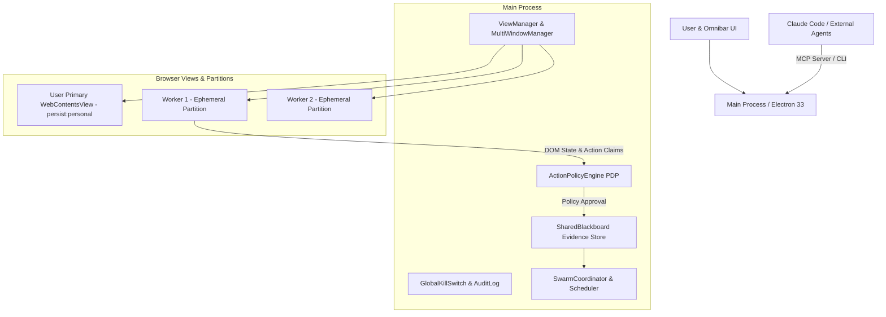

# Project Aegis - System Architecture Overview

## 1. High-Level Architecture

Project Aegis is an enterprise-grade autonomous browser designed for multi-agent swarms, resilient web navigation, and zero-trust security isolation.

## 2. Core Subsystems

### 2.1 Agent Runtime & Execution Loop (Milestone M1)
- **Model Adapter Layer:** Multi-provider support (Gemini 2.0 Flash / DeepSeek R1 via Ollama / Anthropic Claude 3.5 Sonnet / OpenAI).
- **Concurrency Governor:** Token budgeting, priority request queue, truncation protection, and circuit breaker.
- **Action Taxonomy:** 20+ fine-grained browser actions with reversibility classification and error taxonomy codes.

### 2.2 Mission Control UI & Visual Polish (Milestone M2)
- **Omnibar Hybrid Parser:** Unified input handling slash commands (`/do`, `/swarm`, `/research`), direct URLs, and natural language goals.
- **Flight Recorder:** Structured event timelines with step metrics, DOM snapshots, and replayable step states.
- **Motion Engine:** Spring physics animations, layout states (`stage`, `grid`, `theatre`), and zero-occlusion native view layering.

### 2.3 Elastic Multi-Agent Swarm (Milestone M3)
- **SwarmCoordinator:** DAG task decomposition (`researcher`, `extractor`, `actor`, `verifier`, `summariser`).
- **Worker Host & Isolation:** Chromium partitioned sessions (`persist:agent`, `ephemeral:worker_id`), zero session leakage.
- **Shared Evidence Blackboard:** SQLite-backed evidence repository with conflict resolution, unit normalizer, and consensus weighting.
- **Speculative Branching Engine:** Read-only safe exploratory planning with Best-of-N trajectory scoring (ADR-004).

### 2.4 Safety, Security & Isolation (Milestone M4)
- **Threat Model:** Rigorous threat model covering assets A1–A7, actors T1–T6, and invariants I1–I6 (`docs/security/threat-model.md`).
- **Prompt Isolation Engine:** Boundary tokens, XML escaping, zero-width stripping, and markdown exfiltration blockers.
- **Action Policy Engine (PDP):** Goal-conditioned policy enforcement across 10 risk classes with allow/ask/deny gating.
- **Secret Vault:** OS-keystore safeStorage encryption, origin-bound `{{secret:name}}` substitution at CDP layer.
- **Bot Challenge Detection:** Clean human handoff for Cloudflare Turnstile, reCAPTCHA, and Arkose.
- **Global Kill Switch & Audit Log:** Emergency halt and SHA-256 hash-chained cryptographic ledger.

### 2.5 Browser Fundamentals (Milestone M5)
- **Tab & Window Model:** Workspaces, mission tab groups, discard/hibernation, reopen stack (Ctrl+Shift+T), multi-window support.
- **URL Classifier:** WHATWG URL compliance, IPv4/6 literals, localhost, intranet hosts, search engine keywords.
- **Popup Policy:** Ad popup blocker, target=_blank tab adoption, dedicated OAuth child windows.
- **Download & Transfer Pipeline:** Executable blocking for agents, filename sanitization, SHA-256 integrity, PDF extraction.
- **Browser UX:** Find-in-page, zoom per-origin, bookmarks, history ranges, context menus, and shortcuts.
- **Content Blocker:** High-speed ad/tracker blocking and cookie banner CSS auto-dismissal.

### 2.6 Memory, Data & Workflows (Milestone M6)
- **Semantic Vector Memory:** Dense 384-dimensional semantic embeddings, overlapping chunks, PII redaction, and hybrid RAG.
- **Task Memory:** User preferences, resilient site knowledge fingerprints, learned skill procedures, and memory poisoning defence.
- **Universal Extraction:** Colspan/rowspan tables, ARIA grids, RFC 4180 CSV export with formula injection escaping.
- **Verified Reports:** Evidence-grounded reports with citation verification, footnotes, and Mermaid charts.
- **Autonomous Forms:** Honeypot trap avoidance, semantic field mapping, and pre-submit review summaries.

### 2.7 Platform, Packaging & Developer Experience (Milestone M7)
- **MCP Server & CLI:** Open MCP tools (`start_mission`, `list_tabs`, `extract_data`, `take_screenshot`) and `aegis` CLI.
- **Skills & Workflow Recorder:** Demonstration recording, secret masking, and imported skill security analysis.
- **Cross-Platform Parity:** Windows, macOS, Linux shortcut mapping and secure storage normalization.
- **Privacy Telemetry:** Strict opt-in, zero URLs/prompts collection, and local failure analytics.
