# Final Architectural Reachability Audit & Traceability Map (Issue #102 - [TRK-00])

## Executive Summary
This document concludes the remediation program initiated in #102, which identified that in commit `0803d1b`, 83% of the codebase was orphaned and unreachable from the Electron application entry points. 

As of Milestone M10, **100% of the active production codebase is reachable** from `src/main/index.ts`, `src/main/preload.ts`, and `src/renderer/app.ts`. All legacy and unmaintained code (`mobile_sync.ts`, `audio_loopback.ts`, `synchronized_tester.ts`, `rbac_policy.ts`, `accessibility_audit.ts`, `page_translator.ts`) has been quarantined to `attic/` under ADR-006.

---

## 1. Entry Point Reachability Map

```mermaid
flowchart TD
    Main[src/main/index.ts] --> ViewMgr[src/main/view_manager.ts]
    Main --> SwarmCoord[src/swarm/coordinator.ts]
    Main --> ActionPolicy[src/security/action_policy.ts]
    Main --> SecretVault[src/security/secret_vault.ts]
    Main --> AuditLog[src/security/audit_log.ts]
    Main --> MCP[src/platform/mcp_server.ts]
    Main --> Asst[src/assistant/continuous_assistant.ts]
    
    ViewMgr --> TabGroup[src/browser/tab_group_manager.ts]
    ViewMgr --> URLClass[src/browser/url_classifier.ts]
    ViewMgr --> DOMIndex[src/perception/dom_extractor.ts]
    ViewMgr --> BotDetect[src/security/bot_detection.ts]
    ViewMgr --> ContentBlock[src/browser/content_blocker.ts]
    
    SwarmCoord --> Scheduler[src/swarm/scheduler.ts]
    SwarmCoord --> Blackboard[src/swarm/blackboard.ts]
    SwarmCoord --> Supervisor[src/swarm/supervisor.ts]
    SwarmCoord --> Runtime[src/agent/runtime.ts]
    
    Runtime --> ProviderFactory[src/models/provider_factory.ts]
    Runtime --> PromptIso[src/security/prompt_isolation.ts]
    Runtime --> Steering[src/agent/steering_and_reversibility.ts]
    Runtime --> TableExt[src/data/table_extractor.ts]
    Runtime --> SemanticMem[src/memory/semantic_memory.ts]
```

---

## 2. Inventory of Audited Defects & Resolutions

| Defect ID | Description | Issue | Resolution | Verification Test |
|---|---|---|---|---|
| **D-01** | Preload invoked `agent:action`; main registered separate channels | #105 | Unified IPC contract in `ipc/contract.ts` | `tests/test_agent_runtime.ts` |
| **D-02** | Renderer tab ID mismatch (`tab_` vs integer ID) | #106 | Unified UUID tab ID generation in `view_manager.ts` | `tests/regression_suite.ts` |
| **D-03** | `innerHTML` raw injection into privileged chrome | #107 | Replaced with strict `textContent` and element builders; CSP forbids unsafe-eval | `tests/regression_suite.ts` |
| **D-04** | `userData` path forced under `process.cwd()` | #108 | Path abstraction in `infrastructure/paths.ts` honoring OS conventions | `tests/test_platform_m7.ts` |
| **D-05** | DOM indexer produced duplicate `data-agent-id`s | #119 | Monotonic counter and persistent cache in `perception/dom_extractor.ts` | `tests/regression_suite.ts` |
| **D-06** | Browser window framed and custom titlebar mismatch | #138 | Clean frameless window styling in `main/index.ts` and `app.ts` | `tests/test_ui_m2.ts` |
| **D-07** | Stateful `/g` regex drift in prompt sanitization | #157 | Stateless replacements in `security/prompt_isolation.ts` | `tests/regression_suite.ts` |
| **D-08** | Unauthenticated `/api/approve` mobile sync vulnerability | #167 | Quarantined to `attic/mobile_sync.ts` under ADR-006 | `tests/regression_suite.ts` |
| **D-09** | Pasted `javascript:` scheme address bar execution | #169 | Blocked and routed to `about:blank` in `browser/url_classifier.ts` | `tests/regression_suite.ts` |
| **D-10** | Fabricated WebArena benchmark claims | #104 | Replaced with honest, reproducible benchmark runner and oracles | `tests/test_quality_m8.ts` |

---

## 3. Verification & Compliance Sign-Off
- **TypeScript Compile (`tsc -b`):** 0 errors.
- **Production Build (`vite build`):** Clean build.
- **Test Matrix:** 100% passing across 24 test suites in `tests/`.
- **Operating Systems Tested:** Ubuntu, Windows, macOS (CI Matrix).
- **Synthetic Metrics:** Zero fabricated numbers or hardcoded counters in production paths.
