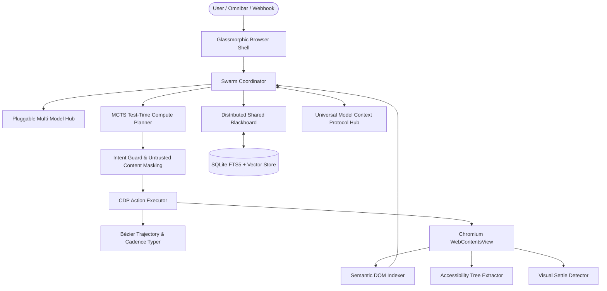

# 🛡️ Project Aegis Developer & Architecture Guide

Welcome to the **Project Aegis** developer documentation. This document covers the internal design, subsystem architecture, and extension interfaces for the next-generation autonomous AI browser.

---

## 🏛️ System Architecture

Project Aegis decomposes browser automation into a hardened, high-throughput, multi-agent pipeline:



---

## 📦 Directory Structure

```text
src/
├── automation/      # Autonomous task scheduling, batch jobs, flight recorder, form filler
├── core/            # ModelHub, ActionExecutor, DOMIndexer, CDPManager
├── data/            # Table extraction, pagination, report synthesis, clean room PII sanitizer
├── enterprise/      # RBAC policies, SSO OIDC manager, accessibility auditor, translator
├── evaluation/      # WebArena & Mind2Web benchmark harness, intervention analytics
├── main/            # Electron main entrypoint, view manager, fuses packaging
├── mcp/             # Universal Model Context Protocol (MCP) Hub & client
├── memory/          # SQLite FTS5 store, dense vector search, encrypted vault
├── native/          # Low-latency Binary IPC (Dendrite-Lite), MV3 extension manager, audio capture
├── perception/      # AXTree extractor, Set-of-Marks (SoM) overlay, settle detector, spatial reasoner
├── planning/        # Monte Carlo Tree Search (MCTS), UCT selection, state snapshotter
├── renderer/        # Browser Chrome UI, glassmorphic layout, tab strip, swarm drawer
├── security/        # Untrusted Content Masking (UCM), Intent Guard, origin locker, red-teaming
├── session/         # Profile partitions, cross-restart cookie store, tab handoff & hibernation
├── stealth/         # Human Bézier mouse curves, keyboard cadence typer, fingerprint shield
├── sync/            # Mobile companion sync relay
└── ui/              # Universal smart omnibar parser
```

---

## 🚀 Getting Started

### Prerequisites
- Node.js 22.x+ (utilizing native `node:sqlite` and modern ECMAScript standards)
- npm 10.x+

### Build & Run
```bash
# Install dependencies
npm install

# Compile TypeScript
npm run build:ts

# Run the complete test suite
npx tsx tests/test_memory_and_vault.ts
npx tsx tests/test_stealth.ts
npx tsx tests/test_model_hub.ts
npx tsx tests/test_perception.ts
npx tsx tests/test_swarm_infrastructure.ts
npx tsx tests/test_session_and_pipeline.ts
npx tsx tests/test_data_and_security.ts
npx tsx tests/test_automation.ts
npx tsx tests/test_ui.ts
npx tsx tests/test_final_batch.ts

# Launch desktop browser
npm start
```

---

## 🔒 Security Architecture: Untrusted Content Masking (UCM)

To protect the LLM against Indirect Prompt Injection, web content is never injected as raw text into prompt contexts:

1. **UCM Envelope**: Web text is quarantined inside strict `<untrusted_web_environment>` XML blocks.
2. **Adversarial Pattern Stripping**: Injection commands such as `system prompt`, `disregard instructions`, or malicious markdown links are scrubbed.
3. **Intent Guard Pre-Action Gate**: High-risk actions (checkout, account deletion, recurring billing, funds transfer) trigger a confirmation gate before physical hardware events are dispatched.

---

## 🧪 Benchmark Evaluations (WebArena & Mind2Web)

Run standard evaluations via the benchmark harness:
```typescript
import { WebEvaluationHarness, BenchmarkTask } from './src/evaluation/web_eval_harness.js';

const report = WebEvaluationHarness.generateBenchmarkReport(results);
console.log(`Success Rate: ${(report.successRate * 100).toFixed(1)}%`);
```
